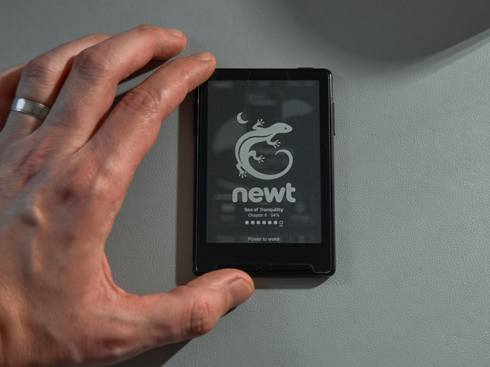
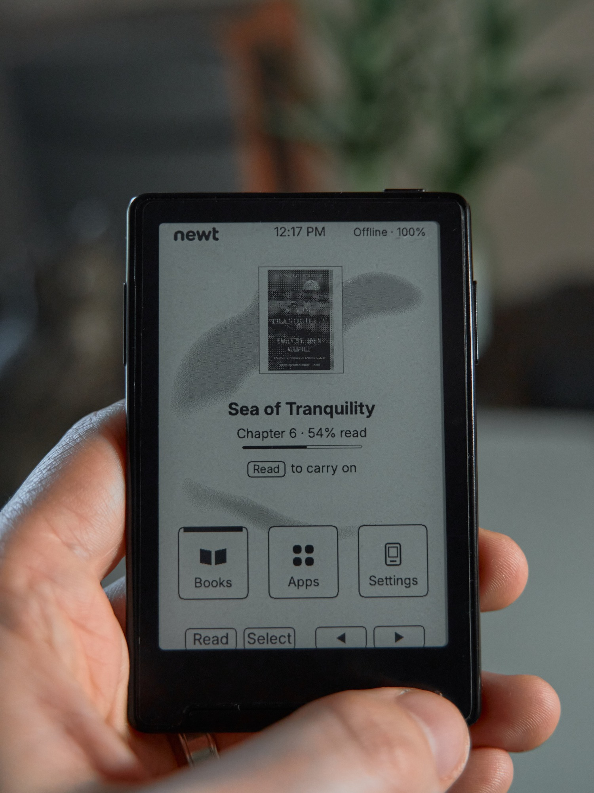
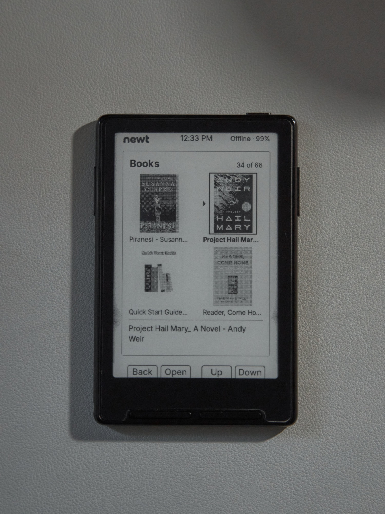
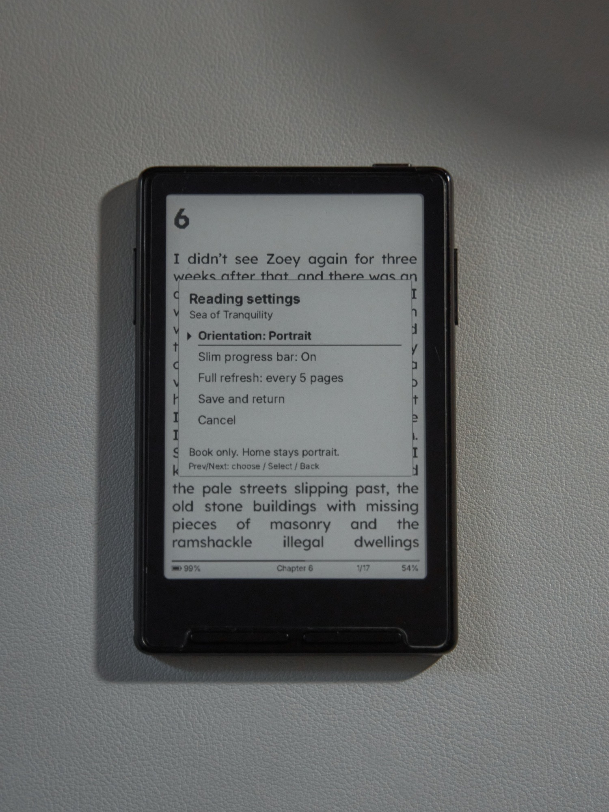
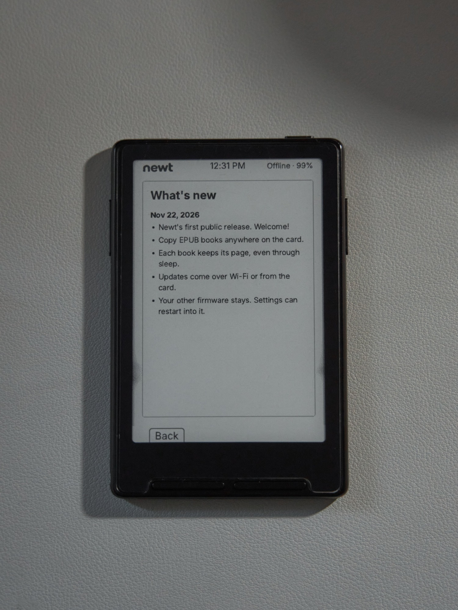

<p align="center">
  <picture>
    <source media="(prefers-color-scheme: dark)" srcset="docs/newt-wordmark-dark.png">
    
  </picture>
</p>

<p align="center">Firmware for the Xteink X3 e-reader.</p>

<p align="center">
  
</p>

Newt is a calm, offline-first reader for your X3. It installs into the X3's
spare app slot, so the firmware you run today stays on the device, and
Newt's Settings can restart into it.

Newt is early alpha software. Expect rough edges, and please
[report what you find](https://github.com/VargasDevelopment/newt/issues).

<p align="center">
  
  
  
</p>

<p align="center">
  
  
  
  
</p>

<p align="center"><sub>Home, Books, Reading settings and What's new on an X3.</sub></p>

## What works today

- **Reading.** EPUB books from anywhere on the card. Chapters, a reading
  menu, portrait or landscape, an optional slim progress bar, and Mark as
  finished. Each book remembers its page. Put the X3 to sleep while reading,
  and it wakes on that page.
- **Home.** The book you are reading, plus Books, Apps and Settings.
- **Reading statistics.** Days read and time of day, per book and overall.
  If the card holds CrossInk's reading history, Newt imports it once.
- **Sleep screen.** Optional extras, off until you turn them on in
  Settings, Sleep screen.
- **Clock.** Time zone and 12- or 24-hour time. Newt sets the clock when it
  checks for updates.
- **Updates.** Over Wi-Fi from GitHub, or from the card. After each update,
  What's new says what changed.
- **Other firmware.** Install any X3 firmware from the card, and restart into
  it from Settings.
- **One small app.** Pocket Pause, under Apps: a short breathing, movement or
  water break.

Reading never needs a network. Wi-Fi is used only for updates.

## Device support

- **Newer X3 units with the UC8279d screen controller** (sold from about
  July 2026): tested.
- **Earlier X3 units with the UC8253 controller:** untested. If you have one,
  a report of what works and what doesn't is very welcome.

Newt runs only on the X3.

## Install

The easiest way is the install page, in Chrome or Edge on a computer:
[vargasdevelopment.github.io/newt](https://vargasdevelopment.github.io/newt/).
It works from the stock firmware and others, on an X3 with its usual storage
layout. Your current firmware stays as the spare until Newt's first update.

If your X3 runs CrossInk, you can also install from the card with `newt.bin`
from the
[latest release](https://github.com/VargasDevelopment/newt/releases/latest).
From CrossPoint this is untested. [INSTALL.md](docs/INSTALL.md) walks
through both.

Copy EPUB books anywhere on the card.

**Updating Newt**

- **Over Wi-Fi:** save your network in Settings, Wi-Fi. Then open
  Settings, Update, and pick Check GitHub for updates.
- **From the card:** copy `newt.bin` and `newt.manifest` from a release to
  the `Newt/Update` folder on the card. Newer Newt makes this folder for you.
  If it isn't there, create `Newt/Update`. Then open Settings, Update.

Your books, reading progress and settings stay as they are.

## Apps from your card (experimental)

Apps holds one small app. It is Pocket Pause unless you install another.

1. Copy one `.newt` app file to the `Newt/Apps` folder on the card (make the
   folder if it isn't there).
2. On the X3, open Home, Apps. Newt shows the app, its version and what it
   can do.
3. Pick Install to replace the app in Apps, or Later to keep the current one.

Newt reads `Newt/Apps` only when you open Apps, and it writes nothing until
you pick Install. It stores the app on the X3 and never changes files on the
card, so you can delete the file afterwards. With no file there, Apps opens
as usual.

To get Pocket Pause back, install its `pocket-pause.newt` file the same way.
After a firmware update, an older `pocket-pause.newt` may look different
from the built-in Pocket Pause, because Newt draws it as a card app.

## Going back

Your old firmware stays in the spare slot until Newt's first update, which
installs into that slot and replaces it (Newt asks first). To go back after
that, you need its `.bin` file, so get it before you update.

- **Restart into the other firmware** (while it is still installed): Settings, Restart into (its name).
  Newt stays in its own slot. If that firmware updates itself, it replaces
  Newt. Install Newt again the same way.
- **Install another firmware:** copy its `.bin` file to the `Newt/Update`
  folder on the card. Newer Newt makes this folder for you. If it isn't there,
  create `Newt/Update`. Then open Settings, Update, and pick it. It replaces
  the spare; Newt stays in its own slot, and the X3 restarts into the new firmware.

To come back to Newt from another firmware, install it the same way you
first did.

## Build from source

```sh
git clone https://github.com/VargasDevelopment/newt.git
cd newt
git submodule update --init vendor/freeink-sdk
```

Only the FreeInk SDK submodule is needed; skip its nested submodules.

Newt builds with a pinned, project-local toolchain (Rust, ESP32-C3 GCC, the
Arduino-ESP32 core, LLVM for host tests, Python 3.12.6), about 2.6 GB to
download. CI sets it up today; [docs/CI.md](docs/CI.md) describes how. A
one-command setup for your own machine is not written yet.

The gate also tests the install page, which needs Node 22.12 or later and
pnpm 9 or later (tested with Node 22.22 and pnpm 11.10; `package.json` pins
neither). Install its locked packages once:

```sh
cd installer && pnpm install --frozen-lockfile && cd ..
```

With the toolchain and those packages in place:

```sh
python3 tools/check.py                                   # the local gate
python3 tools/firmware-build.py --clean --health-report  # the firmware
```

The gate builds and runs the host tests. Its previews (`tools/preview.py`)
run the real firmware, compiled for the host over C fakes of the board, card
and radio (`rust/host/preview`). Previews, compiles and tests on a
real X3 are separate evidence: a passing host test says nothing about the
device.

The install page lives in [installer/](installer/README.md).

## Name and logo

Newt's code is MIT licensed, but the Newt name and the Newt wordmark and logo
images are not covered by the MIT license. You may use the name to refer to
this project, but a modified version you distribute must use its own name and
logo. The images are listed in
[docs/provenance.md](docs/provenance.md#name-and-logo).

## More

- [CONTRIBUTING](CONTRIBUTING.md): how to report issues and send changes.
- [SECURITY](SECURITY.md): how to report a vulnerability privately.
- [LICENSE](LICENSE): Newt is MIT licensed. Third-party parts keep their
  own licenses: [docs/NOTICES.txt](docs/NOTICES.txt) and
  [docs/provenance.md](docs/provenance.md).

Newt is built on [FreeInk](https://github.com/Free-Ink/freeink-sdk).
